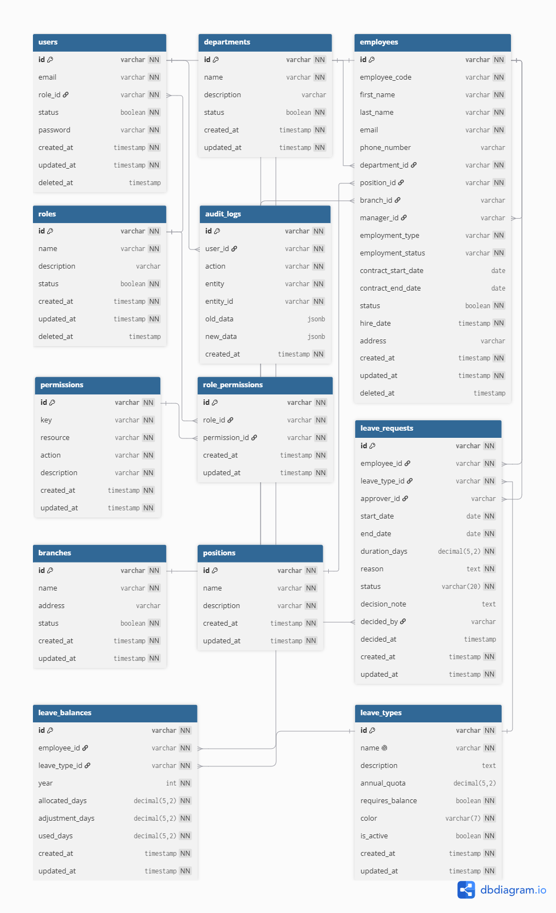

# Employee Management System Backend

Employee Management System (EMS) is a Node.js + Express + Sequelize backend for managing employees, organizational master data, leave requests, and audit logs. It exposes REST API endpoints with JWT authentication, role-based authorization, and CSV export support.

## Demo Live

- Frontend / production demo: https://ems.rayhancreative.web.id
- API base URL: http://localhost:8000 (local development)

## Features

- Authentication and JWT-based session handling
- Short-lived access token (15 minutes) with rotating refresh token and server-side session revocation
- Role-based access control (RBAC) with configurable permissions for `ADMIN`, `HR`, and `EMPLOYEE`
- User management
- Branch and position management
- Department management
- Employee management with department, position, branch, and manager references
- Leave types, requests, approvals, balances, and calendar API
- In-app notifications with an email outbox that retries delivery
- Background jobs for session cleanup and notification delivery (idempotent, one run at a time)
- Audit log tracking for create/update/delete actions
- CSV export for employees and audit logs
- Dashboard summary for employee and activity insights
- OpenAPI contract available at `/api-docs/openapi.json`
- Frontend integration guide: [`docs/fe-integration-guide.md`](./docs/fe-integration-guide.md)
- Frontend Leaves API guide: [`docs/leaves-api.md`](./docs/leaves-api.md)
- HRIS roadmap and phase plan: [`docs/hris-roadmap.md`](./docs/hris-roadmap.md), [`docs/hris-phase-implementation-plan.md`](./docs/hris-phase-implementation-plan.md)

## Tech Stack

- Node.js
- Express
- Sequelize ORM
- PostgreSQL
- JWT
- Zod validation
- ExcelJS for CSV export
- CORS, Helmet, rate limiting

## Project Structure

```bash
.
├── config/
│   └── config.js
├── db/
│   ├── migrations/
│   ├── models/
│   └── seeders/
├── src/
│   ├── docs/
│   ├── middleware/
│   ├── modules/
│   │   ├── branch/
│   │   ├── employee/
│   │   ├── leaves/
│   │   └── position/
│   ├── routes.js
│   └── utils/
├── docs/
│   ├── fe-integration-guide.md
│   ├── hris-phase-implementation-plan.md
│   ├── hris-roadmap.md
│   └── leaves-api.md
├── index.js
├── package.json
├── .env.example
├── README.md
└── .gitignore
```

## ERD / Database Design

The ERD (Entity Relationship Diagram) shows the structure of the database and the relationships between different entities.

The ERD image is already available here:

<p align="center">
  
</p>

You can also open it visually in the project or share it with the team for database reference.

## Local Setup

### 1) Clone the project

```bash
git clone <repository-url>
cd employee-management-system
```

### 2) Install dependencies

```bash
npm install
```

### 3) Configure environment variables

Copy `.env.example` to `.env` and update the values as needed.

```bash
copy .env.example .env
```

Example:

```env
NODE_ENV=development
PORT=8000
JWT_KEY=your_jwt_secret
DB_USER=postgres
DB_PASS=postgres
DB_NAME=postgres
DB_HOST=127.0.0.1
DB_PORT=5432
DB_CONNECTION=postgresql
```

### 4) Create database and run migrations

```bash
npx sequelize-cli db:migrate
```

### 5) Seed the database

```bash
npm run seed
```

### 6) Run the server

Development mode:

```bash
npm run dev
```

Or direct run:

```bash
npm start
```

The application will run on:

```bash
http://localhost:8000
```

### 7) Health check

```bash
curl http://localhost:8000/health
```

Expected response:

```json
{
  "success": true,
  "message": "OK",
  "metadata": {},
  "data": {
    "status": "ok",
    "database": "connected",
    "timestamp": "2026-10-08T00:00:00.000Z"
  }
}
```

## API Documentation

OpenAPI specification is available here:

- `http://localhost:8000/api-docs/openapi.json`

This is the contract used for frontend integration and documentation.

## Main API Endpoints

### Auth

- `POST /api/v1/auth/login` — login and receive JWT token
- `POST /api/v1/auth/refresh` — rotate the refresh token and issue a new access token
- `GET /api/v1/auth/get-me` — get current logged-in user
- `GET /api/v1/auth/sessions` — list active sessions for the current user
- `DELETE /api/v1/auth/sessions/:id/revoke` — revoke one session
- `POST /api/v1/auth/logout` — revoke the current session and clear auth cookies

### Notifications

- `GET /api/v1/notifications` — list the current user's notifications (`unread=true` supported)
- `PATCH /api/v1/notifications/:id/read` — mark one as read
- `PATCH /api/v1/notifications/read-all` — mark all as read

### Dashboard

- `GET /api/v1/dashboard` — summary of employee count, department overview, and recent activity

### Roles

- `GET /api/v1/roles`
- `POST /api/v1/roles/create`
- `GET /api/v1/roles/:id/detail`
- `GET /api/v1/roles/:id/permissions`
- `PUT /api/v1/roles/:id/update`
- `PUT /api/v1/roles/:id/permissions`
- `DELETE /api/v1/roles/:id/delete`

### Users

- `GET /api/v1/users`
- `POST /api/v1/users/create`
- `GET /api/v1/users/:id/detail`
- `PUT /api/v1/users/:id/update`
- `DELETE /api/v1/users/:id/delete`
- `PATCH /api/v1/users/:id/status`

### Departments

- `GET /api/v1/departments`
- `POST /api/v1/departments/create`
- `GET /api/v1/departments/:id/detail`
- `PUT /api/v1/departments/:id/update`
- `DELETE /api/v1/departments/:id/delete`
- `PATCH /api/v1/departments/:id/status`

### Branches

- `GET /api/v1/branches`
- `POST /api/v1/branches/create`
- `GET /api/v1/branches/:id/detail`
- `PUT /api/v1/branches/:id/update`
- `DELETE /api/v1/branches/:id/delete`
- `PATCH /api/v1/branches/:id/status`

### Positions

- `GET /api/v1/positions`
- `POST /api/v1/positions/create`
- `GET /api/v1/positions/:id/detail`
- `PUT /api/v1/positions/:id/update`
- `DELETE /api/v1/positions/:id/delete`

### Employees

- `GET /api/v1/employees`
- `POST /api/v1/employees/create`
- `GET /api/v1/employees/:id/detail`
- `PUT /api/v1/employees/:id/update`
- `DELETE /api/v1/employees/:id/delete`
- `PATCH /api/v1/employees/:id/status`
- `GET /api/v1/employees/export`

Employee create/update uses `position_id` and optional `branch_id`; do not send the removed `work_location` field or the former free-text `position` field. See `/api-docs/openapi.json` for the latest Employee fields, filters, payload examples, and Branch/Position API details.

### Leaves

- `GET /api/v1/leaves/types`
- `POST /api/v1/leaves/types/create`
- `GET /api/v1/leaves/types/:id/detail`
- `PUT /api/v1/leaves/types/:id/update`
- `DELETE /api/v1/leaves/types/:id/delete`
- `GET /api/v1/leaves/requests`
- `POST /api/v1/leaves/requests/create`
- `GET /api/v1/leaves/requests/:id/detail`
- `PUT /api/v1/leaves/requests/:id/update`
- `DELETE /api/v1/leaves/requests/:id/delete`
- `PATCH /api/v1/leaves/requests/:id/decision`
- `PATCH /api/v1/leaves/requests/:id/submit`
- `PATCH /api/v1/leaves/requests/:id/cancel`
- `GET /api/v1/leaves/calendar`
- `GET /api/v1/leaves/balances`
- `POST /api/v1/leaves/balances/create`
- `GET /api/v1/leaves/balances/:id/detail`
- `PUT /api/v1/leaves/balances/:id/update`
- `DELETE /api/v1/leaves/balances/:id/delete`

Leave approval runs in two levels. `LEVEL_1` is the employee's active direct manager; it needs `leave_request.decide_direct_report` and a match on the assigned row. `LEVEL_2` is HR and needs `leave_request.decide`. A manager rejecting at level 1 ends the request; approving moves it to level 2. Balance is consumed only on final approval. The requester can never decide their own request. Requests left at level 1 for `LEAVE_ESCALATION_DAYS` (default 3) are escalated to level 2.

`duration_days` is calculated by the server from the date range and working days. Do not send it; client-supplied values are ignored. A range with no working days is rejected with `400`. Rejected requests can be resubmitted with `PATCH /api/v1/leaves/requests/:id/submit`.

### Audit Logs

- `GET /api/v1/audit-logs`
- `GET /api/v1/audit-logs/export`

## Common Query Parameters

The list endpoints support pagination, sorting, and filtering.

### Pagination

- `page` — default `1`
- `per_page` — default `10`, max `100`

### Search

- `q` — free text search

### Sorting

- `sort_by`
- `sort_order` — `ASC` or `DESC`

### Examples

```bash
GET /api/v1/employees?page=1&per_page=10&q=ali
GET /api/v1/users?role=ADMIN&status=true
GET /api/v1/departments?sort_by=name&sort_order=ASC
GET /api/v1/employees?branch_id=<branch-id>&employment_status=ACTIVE
GET /api/v1/branches?status=true&q=Jakarta
GET /api/v1/audit-logs?action=CREATE&date_from=2026-10-01
```

## Role Model

Supported roles in the system:

- `ADMIN`
- `HR`
- `EMPLOYEE`

Access is controlled using JWT and granular permissions assigned to each role.

### RBAC Feature Overview

The RBAC feature controls access to API resources through permissions assigned to roles. Each permission represents an action on a resource, using a key such as `employee.read`, `employee.create`, or `audit_log.export`. A role can hold multiple permissions, and each user receives the permissions associated with their role.

After authentication, the backend checks the user's active status, role status, and required permission before allowing access to a protected endpoint. Requests without a valid session receive `401 Unauthorized`; authenticated users without the required permission receive `403 Forbidden`. This authorization is enforced by the backend and cannot be bypassed by changing the frontend UI.

The login and `GET /api/v1/auth/get-me` responses include the user's role and permission keys. The frontend can use these keys to show or hide menus, pages, and actions, while still treating the API response as the final authorization decision. For example, the `employee.create` permission can control visibility of the create-employee action.

Administrators can manage roles and their assigned permissions through the role endpoints. `GET /api/v1/roles/:id/permissions` returns permissions assigned to a role, and `PUT /api/v1/roles/:id/permissions` replaces that role's permission list using permission database IDs.

## Frontend Integration Guide

### 1) Authentication

Call the login endpoint and send credentials with every subsequent request:

```js
const response = await fetch(`${API_URL}/api/v1/auth/login`, {
  method: 'POST',
  credentials: 'include',
  headers: { 'Content-Type': 'application/json' },
  body: JSON.stringify({ email, password })
})
```

The backend sets an HttpOnly `token` cookie. The FE should use `credentials: 'include'` and should not store the token in `localStorage`.

After refresh or application startup, call:

```text
GET /api/v1/auth/get-me
```

Use the response to restore the authenticated user and role. Logout must call:

```text
POST /api/v1/auth/logout
```

### 2) API client

Every protected request must include credentials. Centralize this behavior in one API client so that `401` and `403` are handled consistently.

```js
await fetch(`${API_URL}/api/v1/employees`, {
  credentials: 'include'
})
```

Expected handling:

- `401` — clear the local session and redirect to login.
- `403` — keep the session, but show an access-denied state and hide or disable the action.
- `400` — show field or request validation errors.

### 3) Permission-based UI

Do not use only role names to decide whether a button or menu item is visible. Use permission keys:

```js
const can = (permission) => currentUserPermissions.includes(permission)

if (can('employee.create')) {
  // Render the create employee action.
}
```

The main permission keys are:

```text
dashboard.read
user.read              user.create       user.update       user.delete
role.read              role.create       role.update       role.delete
role.permission.assign
department.read        department.create department.update department.delete
branch.read            branch.create     branch.update     branch.delete
position.read          position.create   position.update   position.delete
employee.read          employee.create   employee.update   employee.delete
employee.export
leave_type.read        leave_type.create leave_type.update leave_type.delete
leave_request.read     leave_request.create leave_request.update leave_request.delete
leave_request.decide   leave_request.decide_direct_report
leave_balance.read     leave_balance.create leave_balance.update leave_balance.delete
audit_log.read         audit_log.export
```

The FE must still handle `403` from the API. UI guards improve the experience but are not a security boundary.

### 4) Permission list in the session response

`POST /api/v1/auth/login`, `POST /api/v1/auth/refresh`, and `GET /api/v1/auth/get-me` all return the resolved `permissions` array. The frontend should:

1. Use `permissions` for menu, route, and action guards.
2. Treat the API response as the final authorization decision — a `403` can still occur after a role change.

The access token lives for 15 minutes. When a protected request returns `401`, call `POST /api/v1/auth/refresh` once and retry; do not loop. The refresh token is rotated on every use, and reusing an old one revokes every active session for that user. Revoking a session stops renewal immediately; an access token that was already issued stays valid until it expires, at most 15 minutes.

For the admin role-management screen, the available endpoints are:

```text
GET /api/v1/roles/:id/permissions
PUT /api/v1/roles/:id/permissions
```

The update request replaces the complete permission list:

```json
{
  "permission_ids": ["permission-id-1", "permission-id-2"]
}
```

### 5) Recommended FE screens

- Login and session-expired state
- Dashboard based on `dashboard.read`
- Employee list, detail, create, edit, delete, and export states
- User and role management restricted by their permission keys
- Role permission editor with grouped permissions by resource
- Empty, loading, validation-error, unauthorized, and forbidden states

### 6) FE delivery checklist

- [ ] Configure the API base URL per environment.
- [ ] Enable `credentials: 'include'` on the API client.
- [ ] Restore the session with `GET /api/v1/auth/get-me` on app startup.
- [ ] Add centralized `401` and `403` handling.
- [ ] Add permission helpers for menu, route, and action guards.
- [ ] Do not persist the JWT in `localStorage`.
- [ ] Test the UI with `ADMIN`, `HR`, and `EMPLOYEE` accounts.

## Next Features

Planned improvements for the next development cycle:

- [x] **Granular RBAC permissions** — define permissions per resource and action, such as `employee.read`, `employee.create`, and `audit_log.export`.
- [x] **Role and permission management** — allow administrators to create custom roles and assign permissions without changing application code.
- [ ] **Permission-aware API documentation** — document the required role or permission for each protected endpoint in the OpenAPI specification.
- [ ] **Automated authentication and authorization tests** — cover login, token validation, role restrictions, permission checks, and unauthorized access responses.
- [x] **Refresh token and session management** — 15-minute access token, rotating refresh token, server-side revocation, and a per-device session list.
- [ ] **Employee data import** — add validated CSV/XLSX import with a preview step and an import result report.
- [x] **Notifications** — in-app notifications plus an email outbox drained by a background job. Email delivery requires `SMTP_HOST` and `MAIL_FROM`; without them, messages stay `PENDING` and are retried.
- [ ] **Soft delete and data recovery** — preserve deleted records where required and provide a controlled recovery workflow.
- [ ] **Production observability** — add structured logging, metrics, error tracking, and health checks for dependent services.

## Running Tests

The project uses Node's built-in test runner for focused automated tests. Manual smoke testing is still recommended for API integration.

Recommended local validation flow:

```bash
npm install
npx sequelize-cli db:migrate
npm run seed
npm test
npm run dev
```

Then test the following endpoints:

```bash
curl http://localhost:8000/health
curl http://localhost:8000/api/v1/auth/login
curl http://localhost:8000/api/v1/dashboard
```

If you want to add automated tests later, this project is structured to support it with a dedicated `test/` folder and a standard Node.js test runner.

## Environment Notes

- The backend expects PostgreSQL to be running locally or in your target environment.
- JWT secret and DB credentials must be valid in `.env`.
- `NODE_ENV` should be set according to the environment (`development`, `production`, etc.).
- Email notifications require `SMTP_HOST`, `SMTP_PORT`, `SMTP_USER`, `SMTP_PASS`, and `MAIL_FROM`. Without them, `/health` reports `mail_configured: false` and the outbox keeps retrying instead of dropping messages.
- Background jobs run in-process with `node-cron`. Set `DISABLE_JOBS=true` for test or one-off processes. The design assumes a single Railway instance.
- After migrating, run `npm run link:users` to backfill `users.employee_id` by matching email, then `npm run link:users -- --apply` to write. Users without a match are listed for manual assignment.

## Production / Deployment Notes

### Deployment Architecture

The production application is deployed across three services:

- **Supabase** hosts the PostgreSQL database used by the backend.
- **Railway** hosts this Node.js/Express backend and connects to Supabase using database environment variables.
- **Vercel** hosts the frontend and communicates with the backend through its production API URL.

The database password and JWT secret are configured as environment variables on Railway, not committed to this repository or exposed to the frontend. The backend's `ALLOWED_ORIGINS` must include the production Vercel frontend origin so credentialed API requests can pass CORS checks.

- Ensure the database is migrated and seeded before deployment.
- Set `JWT_KEY` securely in production.
- Configure environment-specific `PORT`, `DB_*`, and `NODE_ENV` values.
- Configure Supabase SSL settings and use the connection details provided by the Supabase project.

## Useful Commands

```bash
npm install
npm run dev
npm start
npm run migrate
npm run seed
npm run seed:undo
npm run migrate:undo
```

## Contact / Maintainer

For questions or technical support, contact the project maintainer or the development team managing this repository.

## License

This project is intended for internal or project-based use unless otherwise specified by the repository owner.
